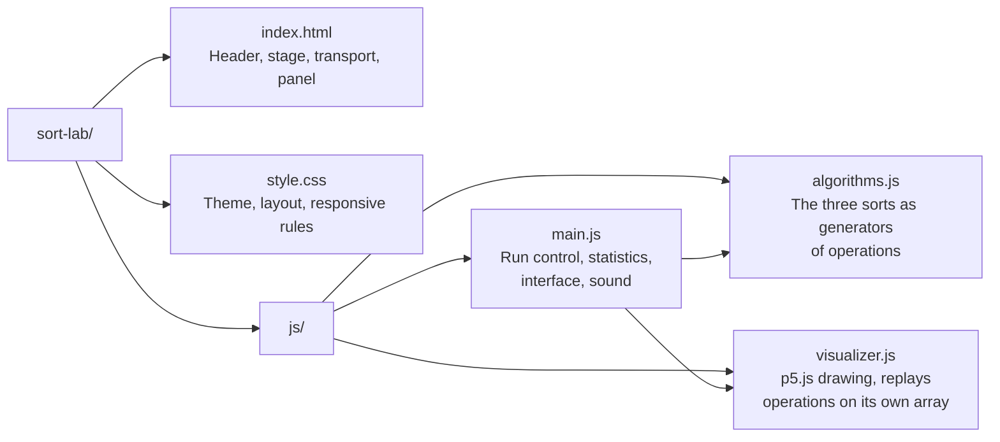
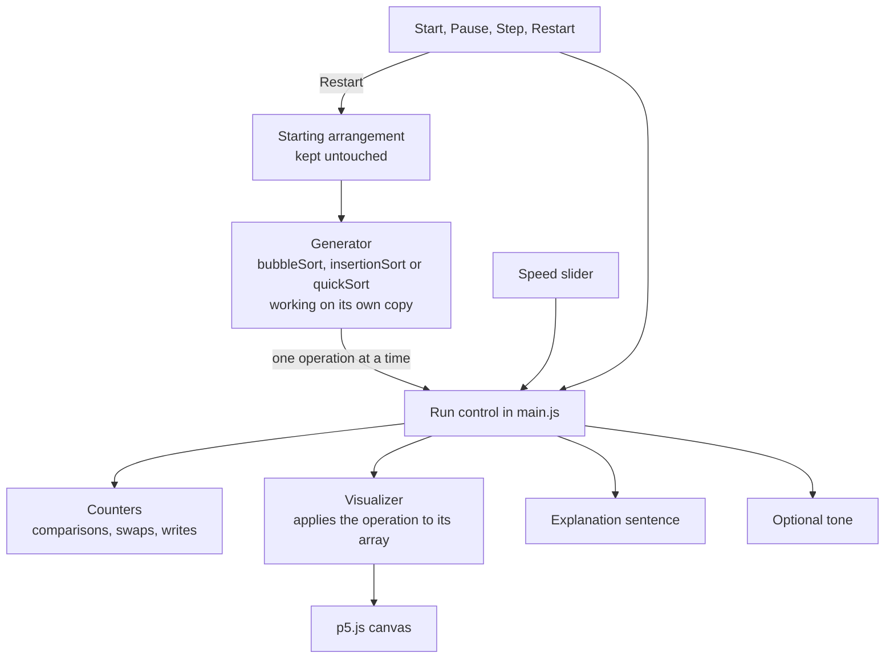

# Sort Lab


An interactive laboratory for sorting algorithms. Generate an array, pick an algorithm and watch it work, one operation at a time.

Built with plain HTML, CSS and JavaScript modules, and [p5.js](https://p5js.org) for the bars. No framework, no build step, no backend.

## Features

- **Three algorithms**: Bubble Sort (with early exit), Insertion Sort and Quick Sort (Lomuto partition).
- **Real operations**: the animation replays what the algorithm actually does (compare, swap, write, choose a pivot), not a generic effect.
- **Full playback control**: start, pause, resume, step forward one operation, restart from the same arrangement.
- **Adjustable speed**: from about 1.5 to 1,500 operations per second, without restarting the run.
- **Three arrangements**: shuffled, nearly sorted and reversed, from 10 to 150 elements.
- **Live statistics**: comparisons, swaps, writes and elapsed time, counted from the operations themselves.
- **Plain explanations**: a sentence describes each operation as it happens, next to the complexity of the algorithm.
- **More than color**: markers under the bars repeat what the colors show (active positions, pivot, active range).
- **Optional sound**: short synthesized tones, pitched by the values, off by default.
- **Responsive**: the bars stay on top on mobile, with the controls below.

## Getting started

The project uses ES modules, so it has to be served over HTTP. Opening `index.html` directly from the file system will not work.

```bash
npx serve .
# or
python -m http.server 8000
```

Then open the URL it prints. In VS Code, the **Live Server** extension works too.

p5.js is loaded from a CDN, so an internet connection is needed. The project can be deployed as is on GitHub Pages.

## How to use it

1. Pick an algorithm, an array size and an arrangement.
2. Click **Start**. The same button then becomes **Pause**, **Resume** and **Run again**.
3. Click **Step forward** to advance exactly one operation.
4. Click **Restart** to go back to the starting arrangement of the current run.

| Shortcut      | Action                 |
| ------------- | ---------------------- |
| `Space`       | Start, pause or resume |
| `Right arrow` | Step forward           |
| `R`           | Restart                |

## The algorithms

| Algorithm      | Best       | Average    | Worst | Idea                                                              |
| -------------- | ---------- | ---------- | ----- | ----------------------------------------------------------------- |
| Bubble Sort    | O(n)       | O(n²)      | O(n²) | Swap neighbours that are out of order, pass after pass.           |
| Insertion Sort | O(n)       | O(n²)      | O(n²) | Insert each value into the sorted section on its left.            |
| Quick Sort     | O(n log n) | O(n log n) | O(n²) | Split the range around a pivot, then sort each side the same way. |

Quick Sort uses the last element of the range as its pivot. That choice is simple to follow, and it also makes sorted and reversed arrays its worst case, which is easy to observe in the lab.

## How the statistics are counted

| Counter    | Counts                                                         |
| ---------- | -------------------------------------------------------------- |
| Comparison | Each time the algorithm compares two values.                   |
| Swap       | Each time two elements exchange positions.                     |
| Write      | Each value stored into the array. A swap counts as two writes. |
| Elapsed    | Time the animation has been running.                           |

The counters come from the operations that were played, never from the number of frames drawn. The elapsed time depends on the speed slider, not on the algorithm. The complexity shown in the app is theory, not a measurement.

## Project structure



## How it works



A few details behind the diagram:

- **Algorithms as generators.** Each sort is a JavaScript generator. It pauses after every meaningful operation and yields an object such as `{ type: 'compare', i, j }` or `{ type: 'swap', i, j }`, with a sentence describing it. The algorithms know nothing about drawing.
- **Playback is counting.** Playing, pausing and stepping all come down to how many operations are requested per frame. A step asks for exactly one. The speed slider only changes that number, so it never restarts the run.
- **Two copies of the array.** The algorithm sorts its own copy. The visualizer replays the operations on another copy, which is the one on screen. The starting arrangement is stored separately and never modified, so a restart always returns to it.
- **One run at a time.** Every control that changes the algorithm or the array goes through the same function, which drops the current generator first. Two runs can never overlap.
- **Light rendering.** All bars are drawn on a single canvas, and the canvas is only redrawn when something changed. The counters on the page are refreshed a few times per second, not on every frame.

## Limitations

- p5.js comes from a CDN, so the project does not work offline.
- At high speeds, several operations are played between two frames, so not all of them are visible.
- The sound is limited to one short tone every 30 ms to stay pleasant at high speed.
- A recent version of Chrome, Edge, Firefox or Safari is required.

## Credits

- Made by [Kone Issa](https://issa.nocerv.com)
- [p5.js](https://p5js.org) for the rendering

## License

[MIT](LICENSE) © 2026 Kone Issa
